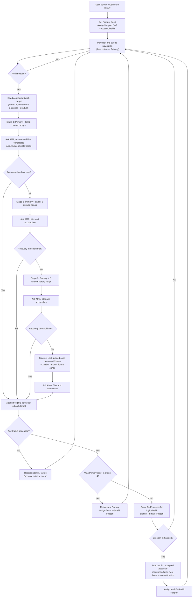

# Project Diary — Radio Infinite: combined flowchart and Exploration Speed

**Date:** 2026-11-23  
**Primary issue:** [#88 — Progressive fallback and adaptive refill recovery](https://github.com/evilnick26/substreamer/issues/88)  
**Related:** [#87 — Rotating Primary Seed and musical inertia](https://github.com/evilnick26/substreamer/issues/87), #77 (Radio Infinite), #86 (duration filtering)

## Objective

Capture the agreed Radio Infinite design as one understandable flowchart, combining the rotating Primary Seed, four progressive fallback stages, filtering and queue replenishment, and the newly proposed listener-facing **Exploration Speed** setting.

## Investigation and design discussion

The number of tracks accepted/appended in a logical refill affects how frequently Radio Infinite replenishes. Since the Primary Seed normally rotates after **3–5 successful logical refills**, smaller appended batches can make the musical anchor rotate sooner *in tracks played*. Larger batches generally preserve that anchor for longer. Smaller batches do **not** intrinsically mean closer musical matches; they mean more frequent re-evaluation of context.

The listener should be offered a choice expressed in musical terms, not implementation parameters:

| Proposed choice | Intended experience | Internal direction |
| --- | --- | --- |
| **Adventurous** | Explore new musical directions more frequently | Smaller batch |
| **Balanced** | A mixture of musical continuity and discovery | Intermediate batch; candidate default |
| **Gradual** | Stay with a musical direction for longer | Larger batch |

**No numerical mappings have been agreed.** The existing ten-track append maximum remains the initial implementation reference, subject to testing and bounded configuration. The Settings UI and persistence are deferred, not requirements for completing #88.

## Combined design flowchart

**Reading the diagram:**

1. **Musical continuity (#87):** A Primary Seed is set when the listener starts a new listening context. Next/Previous, seeking, choosing another song already in the queue, and automatic playback transitions do not reset it. The ordinary AMA seed context is Primary plus the last two queued tracks.
2. **Progressive recovery (#88):** If too few eligible candidates are found, widen seed context in four bounded stages. Retain eligible results from earlier stages; never weaken quality filters. Stage 4 may replace Primary early.
3. **Exploration Speed (future user setting):** Batch target changes how many eligible tracks are appended, influencing refill frequency and thus the pace of anchor rotation. The user sees meaningful words, not seed/refill mechanics.

## Constraints and implementation implications

- Preserve the existing duration **90–480 seconds inclusive**, duplicate, and adjacent same-artist/same-album quality rules across all stages and accumulated batches.
- The **four-eligible-track recovery threshold is provisional** and distinct from the target number appended. A small target may still use a larger recovery threshold, but the precise policy requires testing.
- Count all fallback stages together as **one logical refill** for Primary lifespan; failed or zero-append refills do not advance the normal lifespan.
- Use OpenSubsonic `getRandomSongs` for random library seeds; random seeds need not be queued.
- Cap stages at four; preserve playable queue and report failure/underfill rather than loop indefinitely. Continuous playback is best-effort, not guaranteed under network or library exhaustion.
- Keep session isolation, cancellation, and concurrency safeguards. A new listening context supersedes stale refill work.
- The diagram is a **conceptual design**, not a verified code-level state machine. In particular, the precise lifespan accounting following Stage 4 and the handling of partial/error batches must be resolved consistently during implementation.

## Decisions and status

- **Agreed direction:** Expose the *experience* rather than the mechanism, using **Adventurous / Balanced / Gradual**.
- **Required for #88 implementation:** Make the accepted/appended batch target an internal, bounded configurable parameter and keep the recovery threshold conceptually separate.
- **Enabled for later:** Listener-controlled Exploration Speed.
- **Deferred:** Final batch-size values, Settings UI, preference persistence, and tuning based on listening tests.
- **Implementation status at time of entry:** The four-stage fallback and Exploration Speed changes are **not yet implemented**. This entry records design work and the flowchart; no code changes or tests are claimed.

## Outstanding work

- Implement #87 and #88 and validate behaviour on device.
- Determine practical bounds, default, threshold interaction, early refill buffering, and API/network cost for smaller batches.
- Test whether listeners perceive a useful difference between the three named speeds.
- Revisit this flowchart if the implementation changes any state transitions; preserve this historical entry and record later changes in a new dated entry.
